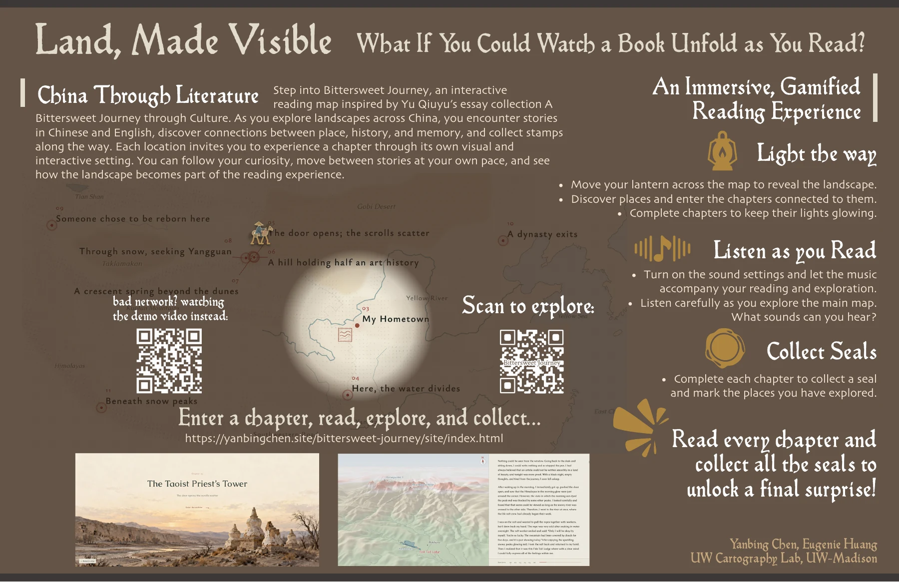

# Land, Made Visible

[Enter the story map](https://yanbingchen.site/bittersweet-journey/) · [Watch the video](https://www.youtube.com/watch?v=Q7rjfPDkKVA) · [View or download the poster (PDF)](<site/assets/Land Made Visible.pdf>)

**An interactive journey through literature and landscape.**

How much of a place can one book reveal? *Land, Made Visible* begins with that question. Inspired by Yu Qiuyu’s *A Bittersweet Journey Through Culture*, it brings nine selected essays into an interactive map. Rivers, deserts, historic sites, and routes appear alongside the writing, giving each chapter a different landscape to explore.

This is a way to read with geography in view: to see how a river can shape a city, how a place carries cultural memory, and how the meaning of a landscape changes when someone writes about it. The original Chinese and an English translation are both available, and you can switch languages as you read.

## How to explore

Your journey starts with *My Hometown*, an introduction to the land through its rivers, terrain, and rainfall. Choose a language, follow the opening sequence, and enter the first reading experience.

From there, the main atlas is yours to explore. Drag the map to move around it, and scroll or pinch to zoom. Bring the lantern toward the map to reveal the landscape. Select a chapter point to enter its story. After the introduction, there is no required reading order: follow the places or questions that interest you.

Each chapter pairs the text with a map designed for that particular story. As you read, watch how the map responds to the places and ideas in the writing. When you finish a chapter, return to the atlas and collect its seal. The landscape gradually lights up as your collection grows. Complete all nine chapters to reveal the ending.

## Before you begin

The experience works on desktop and mobile. If you are using a phone, turn it sideways for the map and reading view. Your progress is saved in this browser, so you can leave and continue later. Use the language switch whenever you want to read in Chinese or English. Sound is optional.

*Text by Yu Qiuyu; English translation by the CN Times Books team. Story map by Yanbing Chen and Eugenie Huang, UW Cartography Lab, UW–Madison.*
